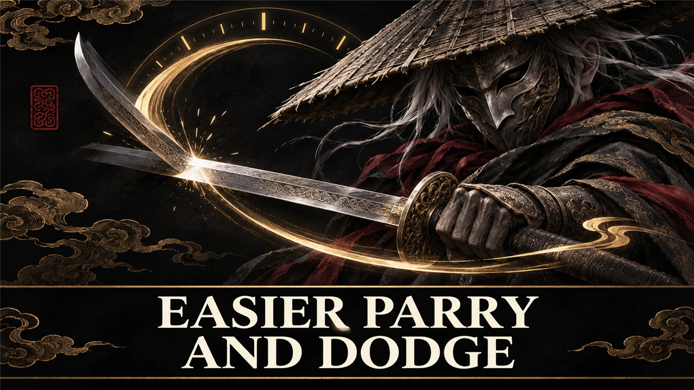

# Easier Parry and Dodge

Wider perfect deflect and perfect dodge windows, with optional slow motion before attacks, auto guard and safer guarding. A PBZModLoader mod, live settings.

## What it does

Perfect deflects and perfect dodges get easier:

- **Wider windows:** the perfect deflect and the perfect dodge windows are 1.5 times as wide by default (Off, x1.25,
  x1.5, x2, x3), or every guard and dodge is perfect (`Always`).
- **Optional:**
  - an exact perfect deflect window in frames, and wider timed-parry windows and deflect lead;
  - a shorter anti-mash penalty after a guard press (`RepeatGuard`);
  - no status build-up and no elemental damage from hits you guard;
  - slow motion when a blue, red or black (power) attack is about to hit you;
  - auto guard: the mod holds guard for you just before a blockable attack hits;
  - the Iron Gauntlets' Fist Guard window follows the deflect window.

It is a PBZModLoader mod: a script in the game's own script engine. It replaces no game file and writes nothing into
your save; every value goes back to the game's when you set it to Off or Game.

## Screenshots

## How to install

1. Install [PBZModLoader](https://github.com/KintaroModding/phantombladezero_pbzmodloader) 2.1.0 or later.
2. Download the zip of the latest release on GitHub (`phantombladezero_easierparryanddodge_<version>.zip`).
3. Unpack it into the game folder (the folder that holds `ProjectPBZ`). It adds the folder
   `ProjectPBZ\PBZModLoader\mods\phantombladezero_easierparryanddodge\` with `main.js` and the settings file.
4. Start the game.

To check that it runs: `ProjectPBZ\PBZModLoader\loader.log` has the line
`[PBZMOD] [Easier Parry and Dodge] <version> started; settings: ...`.

To update the mod, replace `main.js` with the one of the new release; keep your settings file (a setting that it does
not have keeps its default). To remove the mod, delete the folder `ProjectPBZ\PBZModLoader\mods\phantombladezero_easierparryanddodge\`.

## How to use

Nothing to do: the mod works as soon as you load a game. Deflect and dodge as usual.

## Settings

The settings are in `ProjectPBZ\PBZModLoader\mods\phantombladezero_easierparryanddodge\phantombladezero_easierparryanddodge.txt`. Open it with a text editor,
change a value and save: the mod reads the file every 2 seconds, so the game uses it without a restart. Without the
file the mod writes it with the defaults below. Keys are not case-sensitive; `;` or `#` starts a comment.

**With Mods Menu** (0.9.0 or later) in the game, the mod adds its page to Mods Menu's tab in the game's settings, and
the page's settings are the ones that count: Mods Menu keeps them in its own file in the game's `Saved` folder, and
the file in the mod's folder is not read then.

| Setting | Default | What it does |
|---|---|---|
| `Deflect` | `1.5` | The perfect deflect window: `Off` (the game's), `1.25`, `1.5`, `2`, `3`, or `Always` (every guarded hit perfect) |
| `Dodge` | `1.5` | The perfect dodge window, the same values; `Always` keeps every dodge perfect for its whole length |
| `DeflectFrames` | `Game` | An exact perfect deflect window in frames, 1 to 60 (30 a second; the game: 8 on Normal, 10 on Easy); it wins over `Deflect`, not over `Always` |
| `DeflectFramesOnBreak` | `Game` | The same while you are broken (the game: 12 on Normal) |
| `DeflectLead` | `Off` | How long before an enemy hit lands you can already deflect it: `Off`, `1.25`, `1.5`, `2` or `3` times |
| `ParryPerfect` | `Off` | Attacks with a parry cue: the perfect window, `Off` to `3` times |
| `ParryNear` | `Off` | The same for the near windows just before and after it |
| `ParryFail` | `Off` | The same for the fail window |
| `RepeatGuard` | `Game` | The penalty after a quick second guard press: `Game` (0.4 s), `0.3`, `0.2`, `0.1` or `Off` |
| `NoBuildUpOnGuard` | `Off` | `On`: hits you guard or deflect add no status build-up, and a status they set off is taken off at once |
| `NoElementalDamageOnGuard` | `Off` | `On`: a hit you block without a perfect deflect deals no elemental damage |
| `SlowBlue`, `SlowRed`, `SlowBlack` | `Off` | `On`: the world slows down when such an attack is about to hit you |
| `SlowSpeed` | `0.5` | How fast the world runs while slowed: `0.5`, `0.4` or `0.3` |
| `SlowLength` | `1.5` | The longest slowdown in real seconds: `0.5`, `1`, `1.5`, `2` or `3` |
| `SlowStart` | `Hit` | `Hit` (just before the hit) or `Warning` (as soon as the game signals the attack) |
| `AutoGuard` | `Off` | `On`: the mod holds guard for you just before a blockable attack hits (red attacks and grabs stay yours) |
| `FistGuard` | `Game` | `Deflect`: the Iron Gauntlets' Fist Guard window gets wider by the `Deflect` setting |

## Compatibility

- Game version: Steam build 26367565 (`CL-302256_JKS-17280`).
- Needs PBZModLoader 2.1.0 or later. Mods Menu is optional.
- Tested in game with PBZModLoader 2.1.0 and Mods Menu 0.9.1.
- Other mods that change the deflect window, the dodge window or the anti-mash penalty: this mod multiplies the
  values it finds, so another mod's change becomes its base.
- Another mod that slows the world before enemy attacks (for example Reaction Slow-Mo) does the same job as the `Slow`
  rows: use only one of them.
- Mods that react to a perfect parry or a perfect dodge (for example
  [Witch Time](https://github.com/KintaroModding/phantombladezero_witchtime) or Parry or Dodge) use the game's
  windows, so with the wider windows of this mod they come more often.

## Known issues

- The timed-parry windows and the deflect lead are values of each enemy's attacks: an enemy gets them within 2
  seconds after it appears, and an attack the mod first meets while it already swings gets them from its next use.

## How to build

There is nothing to build: `src\phantombladezero_easierparryanddodge\` is the mod folder (`main.js` and the settings file).
`tests\test_mod.js` runs the script outside the game with Node.js and stand-ins for the game: `node tests\test_mod.js`.
`README.md` has the details.

## Credits

Made by Kintaro. MIT license: you may use, change and share this mod. PBZModLoader is made by LKF, its fork by
KintaroModding. Phantom Blade Zero and its files belong to their makers.
